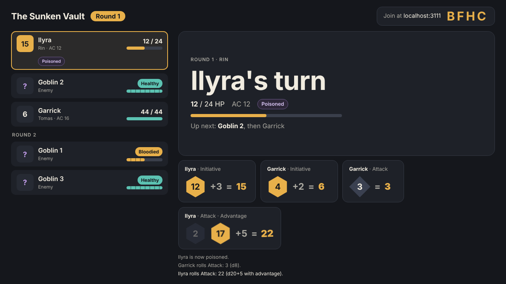
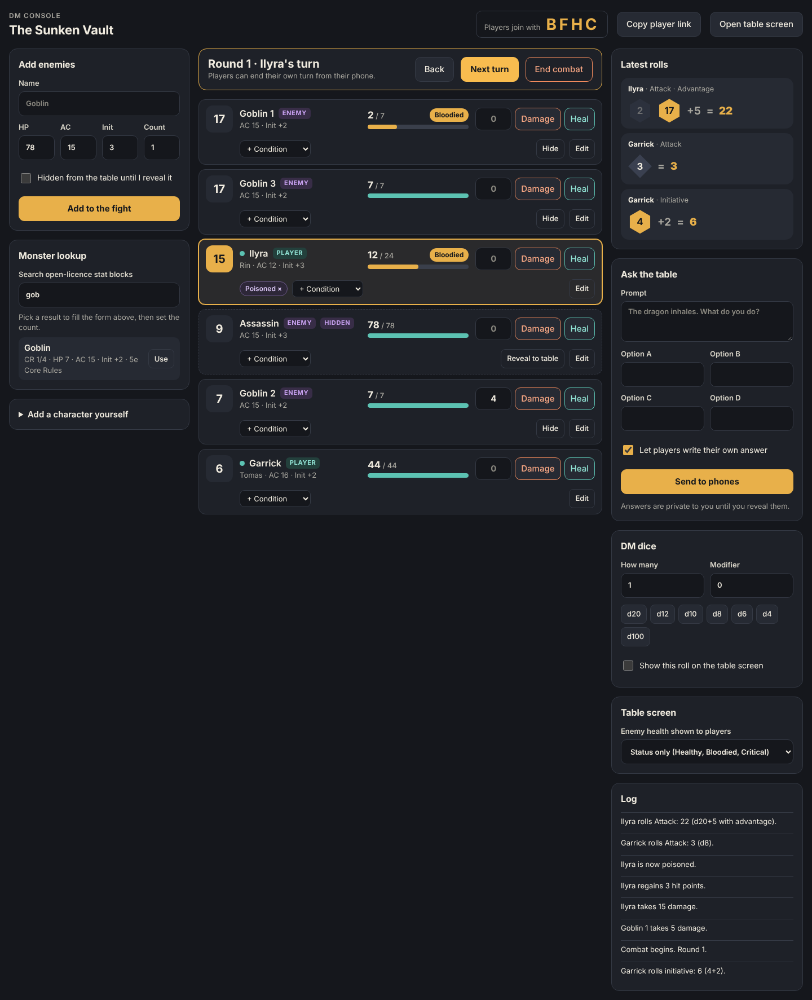
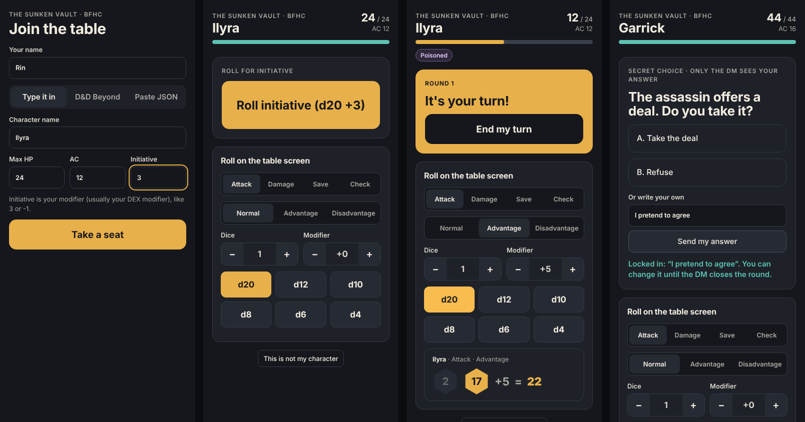

# BattleBox

A combat table for D&D 5e that works like a Jackbox game. The DM runs the fight from one console and shares a table screen on the call. Players join from their phones with a four-letter code to roll initiative, roll dice and end their turn.



| DM console | Phones |
| --- | --- |
|  |  |

## What it does

- **Three screens, one room.** `/dm/CODE` is the private console, `/table/CODE` is the screen you share, `/play/CODE` is the phone controller. Everything syncs live over one WebSocket.
- **Initiative as a moment.** You call for initiative, each player taps Roll, and the d20 tumbles on the table screen before the total appears. Enemies roll in secret and slot into the order.
- **Turn tracking.** The table screen shows whose turn it is, who is next, the round, party HP and conditions. The active player's phone buzzes and gets an "End my turn" button. `N` advances the turn from the console.
- **Fast HP.** Type a number on a row and press Enter for damage or Shift+Enter to heal. Temporary HP is spent first. Only the DM edits HP.
- **Enemies.** Add them by hand (name, HP, AC, initiative modifier, count) or search open-licence stat blocks and fill the form in one click. Enemies can start hidden and be revealed mid-fight; while a hidden enemy acts, the table reads "An unseen foe acts…".
- **Character import.** Players type four numbers, upload or paste a YAML or JSON sheet, or paste a D&D Beyond character link. The DM can load the whole party's sheet files at once.
- **Dice on the big screen.** Any phone can roll d4 to d20 with a modifier, advantage or disadvantage, labelled Attack, Damage, Save or Check. The DM can roll privately or publicly.
- **Secret choice.** Send a prompt with up to four options or a write-in. Answers reach only the DM, who reveals them on the table or closes the round and narrates.
- **Saved to disk.** Each room is one JSON file. A restart mid-fight loses nothing, and next session players pick their existing character from a list.

## Run it

### Docker

```bash
docker compose up -d
```

Open <http://localhost:3000>, create a table, and keep the DM link it sends you to.

### Without Docker

Needs Node 20 or newer.

```bash
npm install
npm start
```

## Let remote players in

Phones outside your network need a public HTTPS address. Two ready-made options use Cloudflare Tunnel, so no ports are opened on your router.

**Temporary address, no account:**

```bash
docker compose --profile quick up
```

The `quick-tunnel` logs print a `https://….trycloudflare.com` address. It changes on every start.

**Stable address on your own domain:**

1. In the Cloudflare Zero Trust dashboard, create a tunnel and add a public hostname that points to `http://battlebox:3000`.
2. Copy `.env.example` to `.env` and paste the tunnel token into `TUNNEL_TOKEN`.
3. `docker compose --profile tunnel up -d`

Any other reverse proxy works too, as long as it forwards WebSocket upgrades on `/ws`.

## A session, start to finish

1. Open the site, create a table. You land on the DM console; the address contains your private DM key after the `#`. The start page remembers your tables in that browser.
2. Click **Open table screen** and share that window on your call.
3. Players open the site on their phones, enter the code, and add their character.
4. Add enemies on the left. Tick **Hidden** for anything the party has not seen.
5. **Call for initiative.** Players tap Roll. **Roll for the rest** covers anyone who is away. **Start combat.**
6. Run turns with **Next turn** (or `N`), apply damage and conditions on each row.
7. **End combat** removes the enemies and keeps the characters, with their current HP, for the next fight.

## Importing characters

| Method | What the player does | Notes |
| --- | --- | --- |
| Type it in | Name, max HP, AC, initiative modifier | Always works |
| D&D Beyond link | Pastes `dndbeyond.com/characters/12345678` | The character's privacy must be Public. The server reads D&D Beyond's character JSON, which is unofficial and can change. |
| Sheet file | Uploads or pastes a `.yaml` / `.json` sheet | See the fields below. The DM can also import several files at once from the console. |
| Minimal JSON | Pastes `{"name":"Ilyra","maxHp":24,"ac":12,"initMod":3}` or a D&D Beyond export | `dex` (the score) can stand in for `initMod` |

An import only fills the form. The player checks the numbers before taking a seat. HP and initiative follow the sheet's maths; AC covers armour, shields, flat bonuses and unarmoured defence, and can miss unusual features.

### Sheet files

A YAML (or JSON) sheet is read through these keys; everything else in the file is ignored:

```yaml
name: Pijo
className: Sanguine Mage     # shown next to the import, optional
level: 2                     # optional
hitPointMaximum: 21
currentHitPoints: 17         # optional, defaults to the maximum
temporaryHitPoints: 0        # optional
armorClass: 12               # optional, defaults to 10 + DEX modifier
initiativeOverride: 2        # optional, defaults to the DEX modifier
abilities:
  dexterity:
    score: 15
```

The numbers are used exactly as written; nothing is recalculated from equipment. Importing a sheet whose name matches a character already at the table updates that character (max HP, current HP, temp HP, AC, initiative) and keeps its conditions and place in the turn order, so editing the file and importing it again is the way to change stats between or during fights.

Monster lookup uses the [Open5e](https://open5e.com) API. If the server has no internet access, add enemies by hand.

## What players can and cannot see

| | DM console | Table screen and phones |
| --- | --- | --- |
| Hidden enemies | Yes | No, not even the name |
| Enemy HP | Exact | Healthy / Bloodied / Critical / Down (switchable to exact) |
| Enemy initiative rolls | Yes | Position in the order only |
| Secret-choice answers | Live | Only after **Reveal on table** |
| Private DM rolls | Yes | No |

This is enforced on the server: each screen is sent only the data it may show.

## Settings

| Variable | Default | Meaning |
| --- | --- | --- |
| `PORT` | `3000` | Port to listen on |
| `DATA_DIR` | `./data` (`/app/data` in Docker) | Where room files are written |
| `MAX_ROOMS` | `200` | Cap on saved tables |

Room files live in `DATA_DIR/rooms/CODE.json`. Delete a file (with the server stopped) to remove a table. With Docker the data is in the `battlebox-data` volume.

## Development

```bash
npm run dev   # restarts on change
npm test      # rules and importers
```

```
server/rooms.js      every rule: initiative, turns, HP, prompts, and what each screen may see
server/importers.js  YAML/JSON sheets, D&D Beyond and Open5e mapping
server/index.js      HTTP, WebSocket and saving to disk
public/              the three screens, plain HTML/CSS/JS, no build step
test/                node:test suites
```

## Known limits

- Built for one trusted group. Anyone who can reach the site can create a table, and players can claim any saved character that nobody is currently holding.
- No maps, tokens, spell slots, death-save tracking or legendary actions.
- One DM per table. The DM link is the only key; if it leaks, create a new table.

## Later: a Discord Activity

The app is an ordinary web app on purpose. A Discord Activity is a web app in an iframe, so wrapping this one means adding Discord's Embedded App SDK for identity (replacing the room code and name field) and pointing the Activity's URL mapping at this server. The game logic and screens stay as they are.
