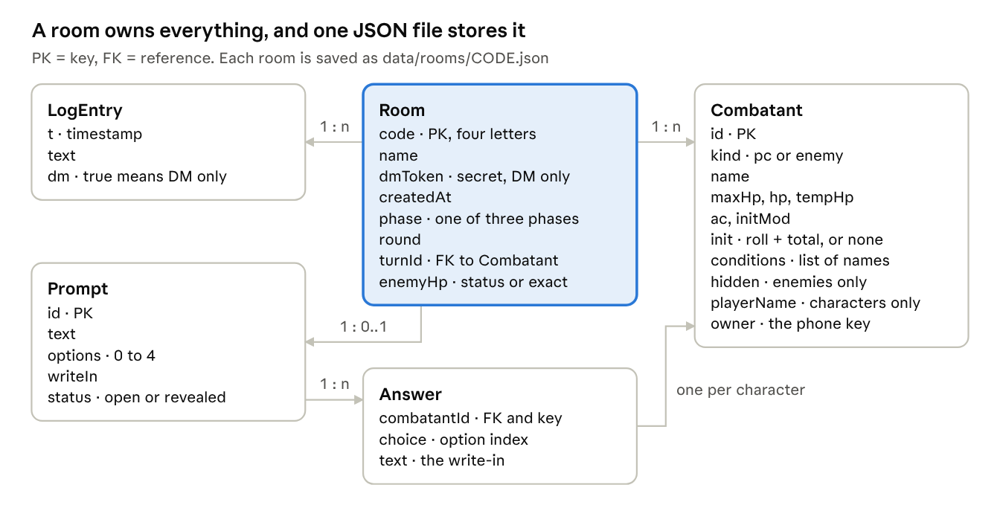
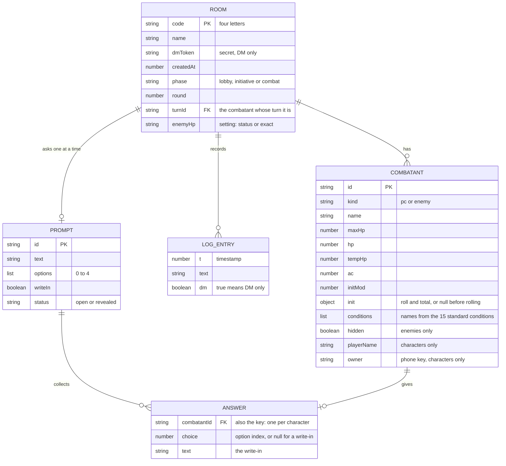

# BattleBox: Data Model (ERD)

Companion documents: [BRD](BRD.md) and [Flow](FLOW.md).

A room owns everything, and one JSON file stores it. There is no database: each room is saved as `data/rooms/CODE.json`.



The same model as an editable Mermaid diagram, with field types:



Initiative and conditions live inside the combatant, and the enemy-health setting lives inside the room (`settings.enemyHp`), so neither is a separate entity. Live connections (which phone or screen is online) are held in memory and never saved.

## Entities

| Entity | What it holds | How long it lives |
| --- | --- | --- |
| Room | The table: code, DM secret, phase, round and whose turn it is | Until its file is deleted |
| Combatant (pc) | A player character and the key of the phone that holds it | Across fights and sessions |
| Combatant (enemy) | A monster in the current fight | Until the DM ends combat or removes it |
| Prompt | The one secret-choice question in play | Until the DM closes or clears it |
| Answer | One character's reply to the prompt | As long as its prompt |
| LogEntry | One line of the fight log, public or DM-only | The newest 200 per room |

## The file on disk

One room file looks like this, trimmed to one combatant:

```json
{
  "v": 1,
  "code": "KRBT",
  "name": "The Sunken Vault",
  "dmToken": "<32 hex characters>",
  "createdAt": 1794880000000,
  "phase": "combat",
  "round": 2,
  "turnId": "a1b2c3d4e5f6",
  "combatants": [
    {
      "id": "a1b2c3d4e5f6",
      "kind": "pc",
      "name": "Pijo",
      "maxHp": 21,
      "hp": 17,
      "tempHp": 0,
      "ac": 12,
      "initMod": 2,
      "init": { "roll": 14, "total": 16 },
      "conditions": ["Poisoned"],
      "hidden": false,
      "playerName": "Rin",
      "owner": "<phone key>"
    }
  ],
  "prompt": {
    "id": "0f9e8d7c6b5a",
    "text": "The assassin offers a deal. Do you take it?",
    "options": ["Take the deal", "Refuse"],
    "writeIn": true,
    "status": "open",
    "answers": { "a1b2c3d4e5f6": { "choice": 1, "text": "" } }
  },
  "log": [{ "t": 1794880123456, "text": "Combat begins. Round 1.", "dm": false }],
  "settings": { "enemyHp": "status" }
}
```

## What each screen receives

The stored room is never sent as it is. `server/rooms.js` builds a view per role:

| View | Built by | Differences from the stored room |
| --- | --- | --- |
| DM | `dmView` | Everything except `dmToken` and phone keys; adds each combatant's health band and whether its phone is connected |
| Table | `publicView` | No hidden enemies, no enemy HP numbers (unless the setting is exact), no enemy rolls, no DM-only log lines, no answers until revealed |
| Player | `playerView` | The table view plus which character is theirs, their own answer, and the saved characters they could claim |
