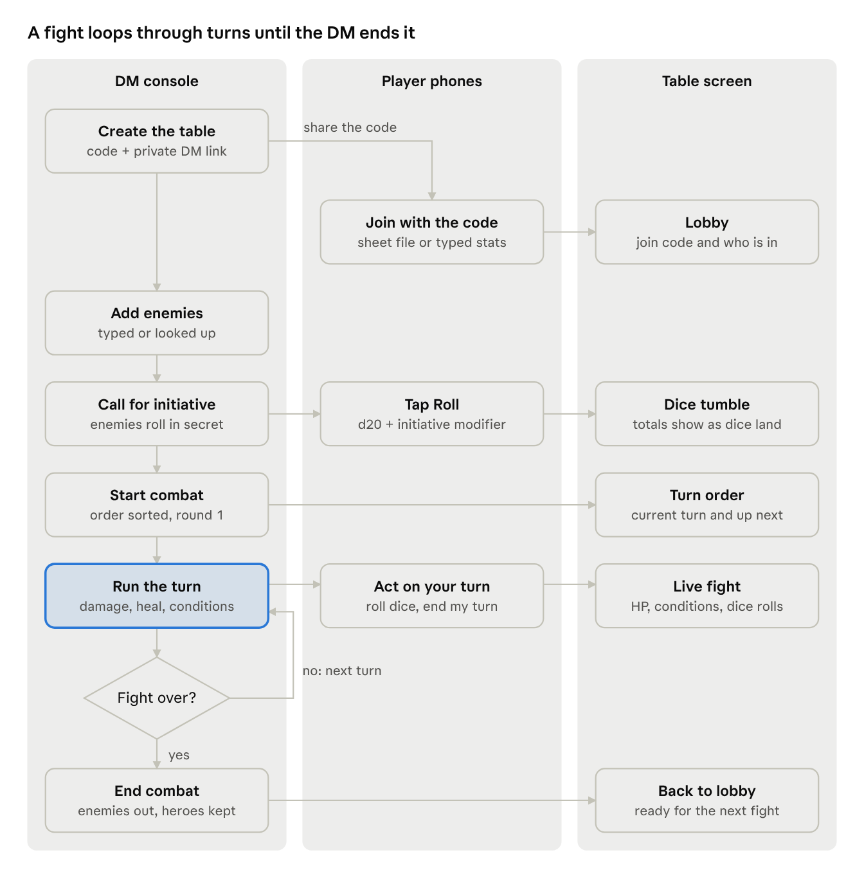
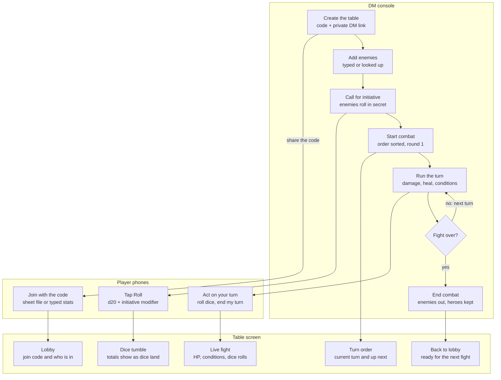
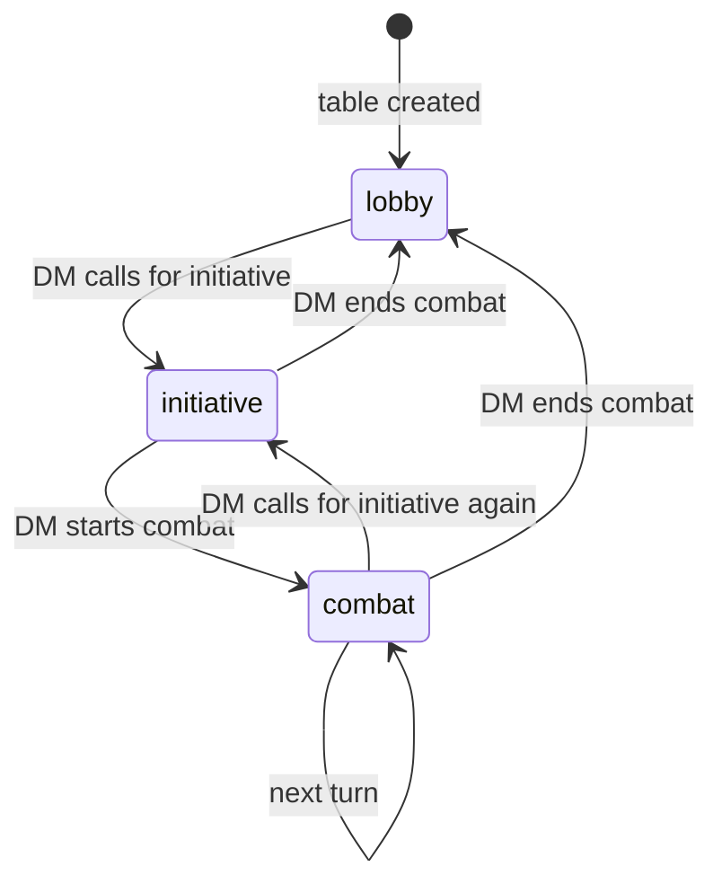

# BattleBox: Session Flow

Companion documents: [BRD](BRD.md) and [ERD](ERD.md).

A fight loops through turns until the DM ends it. A session moves through three phases (lobby, initiative, combat) and returns to the lobby when the DM ends the fight.

The same flow as an editable Mermaid diagram:

Read each lane top to bottom. The DM drives every step, phones act only when asked, and the table screen mirrors the result. The loop between "Run the turn" and "Fight over?" repeats once per turn, and the round number rises each time the order wraps. A secret-choice prompt can be sent at any point without leaving the current phase.

## Phases

The room's `phase` field decides what every screen shows.

| Phase | DM console | Phones | Table screen |
| --- | --- | --- | --- |
| lobby | Add enemies and characters, then call for initiative | "You're in", dice pad | Join address, room code, who has joined |
| initiative | See who has rolled, roll for the rest, start combat | Roll initiative button, then the total | A tile per character; totals appear as dice land |
| combat | Next turn, damage, heal, conditions, end combat | Turn banner, "End my turn" on your turn, dice pad | Turn order, current turn, up next, dice cards |

## Rules the flow follows

- Turn order is highest initiative total first. Ties go to the higher modifier, then to player characters, then to whoever was added first.
- Enemies at 0 HP are skipped. Characters at 0 HP still get their turn.
- A combatant added during initiative or combat rolls at once (enemies) or is asked to roll (characters), and slots into the order.
- Removing whoever is acting passes the turn to the next combatant.
- Ending combat removes enemies, clears initiative, and keeps characters with their current HP and conditions.
